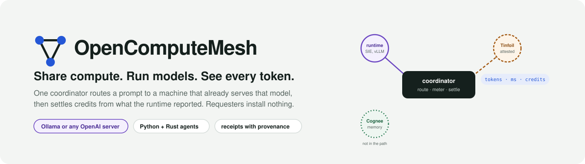
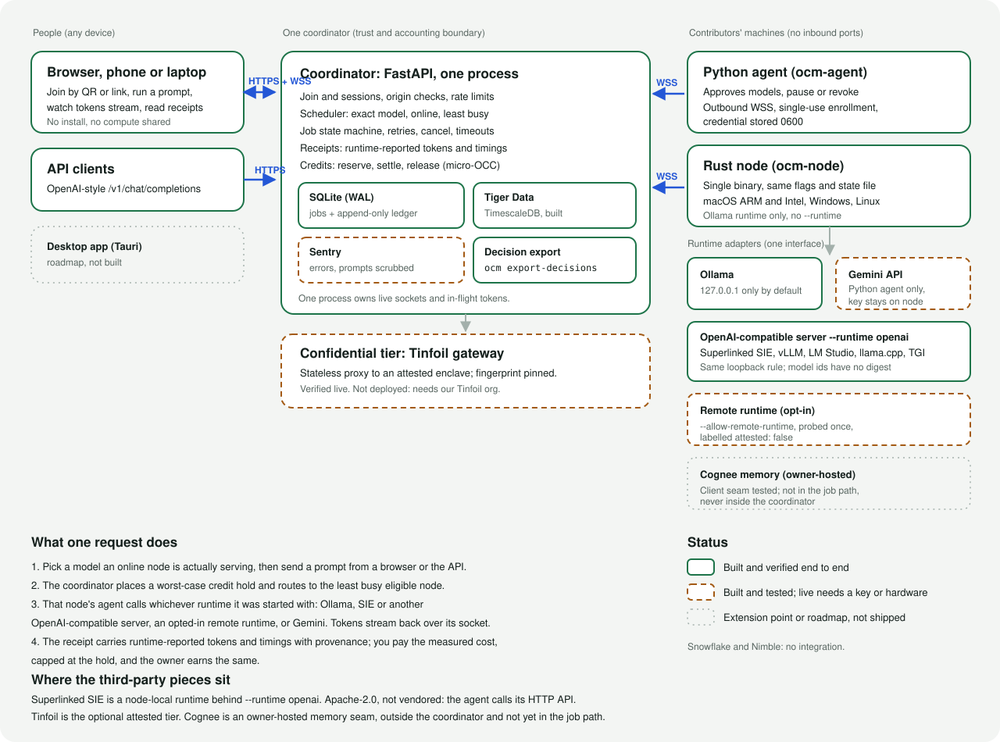

<p align="center">
  
</p>

<p align="center">
  <a href="https://github.com/roshaninfordham/opencomputemesh/actions/workflows/ci.yml"></a>
  <a href="LICENSE"></a>
  
  
</p>

# OpenComputeMesh

Pool the models a few machines already run. One person hosts a coordinator, anyone with a GPU runs a
small agent beside Ollama (or any OpenAI-compatible server) and shares only the models they approve,
and everyone else joins from a browser. Each prompt streams back with a receipt: which node answered,
what the runtime reported, and the credits that moved.

Opening the coordinator shares nothing. Compute exists only while an agent is running, and that agent
dials out, so there are no ports to open and nothing to install to ask for a token.

**[Watch the 2-minute demo](https://www.youtube.com/watch?v=pevKYZLvLoE)** · [Architecture](docs/ARCHITECTURE.md) · [Releases](https://github.com/roshaninfordham/opencomputemesh/releases)

## What runs today

- **Coordinator, web app, Python agent.** 97 tests pass; 3 skip without the optional extras or a live Ollama.
- **`ocm-node` (Rust).** Same flags and state file as the Python agent, Ollama runtime only. Binaries for macOS (ARM and Intel), Windows x64 and Linux.
- **Runtimes.** Ollama on loopback by default; `--runtime openai` for SIE, vLLM, LM Studio, llama.cpp or TGI; `--runtime gemini`; an opted-in remote runtime. The Rust agent does Ollama only.
- **Tinfoil attested tier.** The gateway was verified against a live enclave with the fingerprint pinned. It is not deployed: that needs our Tinfoil organization, so there is no public URL yet.
- **Cognee memory.** An owner-hosted client seam, tested against a local instance. It is not in the job path.
- **House decision model.** The labelled dataset ships via `ocm export-decisions`; nothing is trained and no accuracy is claimed.

Nothing is code-signed yet. See [docs/RELEASING.md](docs/RELEASING.md).

## Quick start

**1. Host a network.** One machine with Python 3.12+ and [uv](https://docs.astral.sh/uv/). The wheel
does not contain the web app, so fetch both assets from [the latest release](https://github.com/roshaninfordham/opencomputemesh/releases).

```bash
BASE=https://github.com/roshaninfordham/opencomputemesh/releases/download/v0.1.3
curl -LO $BASE/opencomputemesh-0.1.3-py3-none-any.whl
curl -LO $BASE/opencomputemesh-web-0.1.3.zip
unzip -q opencomputemesh-web-0.1.3.zip -d web/dist
uv tool install ./opencomputemesh-0.1.3-py3-none-any.whl
OCM_WEB_DIST=./web/dist ocm serve
```

It prints `Join path: /join/<code>` and binds `127.0.0.1:8000` unless you set `OCM_HOST`.

**2. Share your models.** Install [Ollama](https://ollama.com), pull a model, create an enrollment
token under Nodes in the web app, then run the binary for your OS. It dials out and opens no ports;
macOS builds are unsigned, so clear the quarantine bit first.

```bash
BASE=https://github.com/roshaninfordham/opencomputemesh/releases/download/v0.1.3
curl -LO $BASE/ocm-node-0.1.3-aarch64-apple-darwin
chmod +x ocm-node-0.1.3-aarch64-apple-darwin
xattr -d com.apple.quarantine ocm-node-0.1.3-aarch64-apple-darwin
ollama pull qwen2.5:1.5b
./ocm-node-0.1.3-aarch64-apple-darwin \
  --coordinator https://your-coordinator \
  --models qwen2.5:1.5b --name my-laptop
```

Linux uses the musl binary, Windows the `.exe`, with the same flags. The Python agent is the
alternative: `ocm-agent --coordinator https://your-coordinator --models qwen2.5:1.5b`.

Already serving SIE, vLLM or LM Studio? `ocm-agent --runtime openai --base-url http://127.0.0.1:8080`
shares it with no Ollama involved. A non-loopback runtime is refused unless the owner passes
`--allow-remote-runtime`, and then its receipts say `runtime_scope: remote` and `attested: false`.

**3. Join from any device.** Open `/join/<code>` and pick a nickname. No install, no account, and
joining shares no compute.

Check a host with `curl /healthz` and `ocm check-ledger`. The OpenAI-compatible API is
`POST /v1/chat/completions` with a Bearer API key created in the app.

## What the receipts promise

- **Reported, not estimated.** Token counts and timings come from the runtime, the coordinator or the
  browser, and the receipt says which. A value nobody reported stays empty.
- **Capped charges.** A worst-case credit hold is placed before routing and settled to the measured
  cost, never above the hold. `ocm check-ledger` proves every job's debit and reward cancel out.
- **No prompt storage.** Prompts live in coordinator memory for the length of a job, never in the
  database or logs. Optional Sentry reporting strips bodies, cookies, tokens and join codes first.
- **Honest tiers.** Only the Tinfoil enclave can be attested. Contributor machines, remote runtimes
  and Gemini are labelled for what they are.

## How a request moves

<p align="center"></p>

1. A prompt arrives from the browser or the API; the coordinator picks an online node that actually
   serves that exact model, least busy first.
2. It places the credit hold and sends the job over the node's outbound socket.
3. The agent calls whichever runtime it was started with and streams tokens back.
4. The receipt records runtime-reported usage with provenance, the hold settles, and the receipt is
   readable in the web app and over the API.

## Docs

| | |
|---|---|
| [Architecture](docs/ARCHITECTURE.md) | The coordinator, receipts, ledger, security model and where third-party software sits |
| [Sponsors](docs/SPONSORS.md) | What was verified for Gemini API, Tiger Data, Sentry, Tinfoil and Cognee |
| [Releasing](docs/RELEASING.md) | Cutting a version and checking the assets |
| [Security](SECURITY.md) · [Contributing](CONTRIBUTING.md) · [Changelog](CHANGELOG.md) | |

Apache-2.0.
