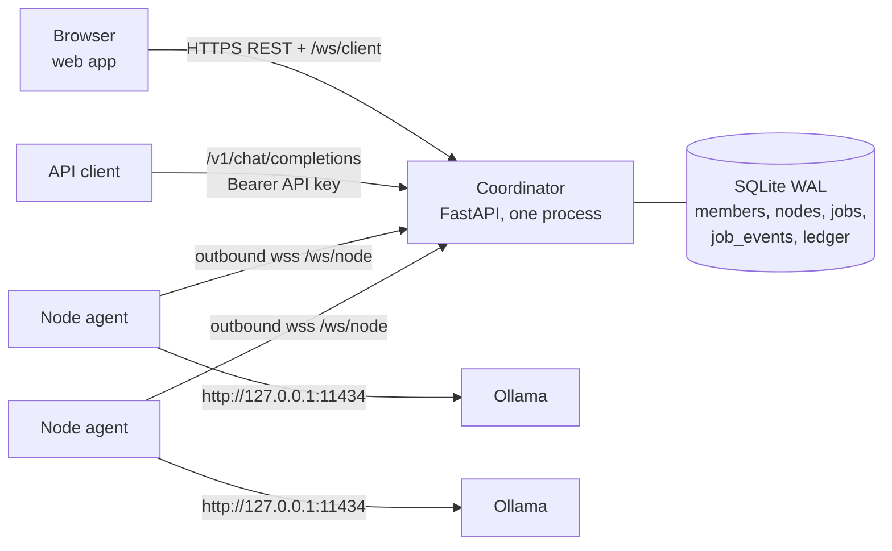

# OpenComputeMesh

[](https://github.com/roshaninfordham/opencomputemesh/actions/workflows/ci.yml) [](LICENSE)

Share compute. Run models. See every token.

OpenComputeMesh v0.1 lets a small group pool the language models they already run locally with [Ollama](https://ollama.com). One person runs a coordinator. Others join it in a browser, and anyone who wants to contribute compute runs a small node agent next to their own Ollama. A prompt sent from the web app (or the OpenAI-compatible API) is routed to one online worker that has the exact model. The tokens stream back, and each request gets a receipt that shows runtime-reported token counts, timings, and the OpenCompute Credits (OCC) moved between requester and provider.

Opening the coordinator URL does not share anyone's compute. A browser that joins can only send requests. Compute is shared only when someone runs the node agent on a machine that has Ollama running and at least one model already pulled, and approves which of those models to share. The agent connects out to the coordinator over a WebSocket. It opens no inbound ports and talks to Ollama on loopback only.

## What it looks like

These screenshots come from real runs against `qwen2.5:1.5b` on Ollama 0.17.7. Every number is measured.

| A receipt after a run | Local node vs shared network | Phone |
|---|---|---|
|  |  |  |

The comparison shown ran both nodes on the same Mac, so it demonstrates the mechanics, not a hardware difference.

## Components

| Part | Code | What it does |
|---|---|---|
| Coordinator | `ocm/app.py`, `ocm/hub.py`, `ocm/ledger.py`, `ocm/db.py`, `ocm/config.py`, `ocm/cli.py` | FastAPI app (one process). Serves REST, WebSockets, the OpenAI-compatible subset and the built web app. Stores everything durable in SQLite (WAL mode). |
| Node agent | `ocm/agent.py`, `ocm/runtime.py` (CLI `ocm-agent`) | Outbound-only WebSocket client. Enrolls with a one-time token, then runs jobs against local Ollama and streams tokens back. |
| Web app | `web/` (React + Vite) | Built to `web/dist` and served by the coordinator from the same origin. Join, run a model, view receipts, nodes, usage and the ledger. |
| Rust agent (alternative) | `crates/ocm-node` | A Rust node agent, binary `ocm-node`, with the same flags, environment variables and `<state-dir>/node.json` state file as `ocm-agent`. Build with `cargo build --release --manifest-path crates/ocm-node/Cargo.toml`. Covered by its own `cargo test` suite and verified end to end against the coordinator. |

## Quick start

Requirements: Python 3.12 or newer (the repo pins 3.13), [uv](https://docs.astral.sh/uv/), Node.js with npm, and Ollama on every machine that will share compute.

From a clean checkout:

```bash
uv sync                      # Python dependencies (including dev group)
scripts/build_web.sh         # npm ci + npm run build in web/ -> web/dist
uv run ocm serve             # coordinator on http://127.0.0.1:8000
```

`ocm serve` prints `Join path: /join/<code>`. You can print the code again at any time with:

```bash
uv run ocm join-code
```

Open `http://127.0.0.1:8000/join/<code>` in a browser and pick a nickname. In demo mode each new member gets a 100 OCC grant.

To share compute from the same machine:

```bash
ollama serve                 # if it is not already running
ollama pull qwen2.5:1.5b     # any model you choose; qwen2.5:1.5b is the recommended demo model
```

In the web app go to Nodes, open "Share my compute" and create a one-time enrollment token. Then:

```bash
uv run ocm-agent --coordinator http://127.0.0.1:8000 --models qwen2.5:1.5b --name my-laptop
```

The agent asks for the token with a hidden prompt. For non-interactive runs set `OCM_ENROLLMENT_TOKEN` in the environment instead. After enrollment the agent saves a node credential to `~/.opencomputemesh/node.json` (mode 0600). Later runs reuse it and need no token. Use `--state-dir DIR` to keep a separate credential per node, for example when simulating two nodes on one machine.

Other agent flags: `--ollama` (default `http://127.0.0.1:11434`, loopback only), `--max-jobs` (default 1), `--heartbeat` (seconds, default 20). `--coordinator` can also come from `OCM_COORDINATOR` or from the saved state.

To let people on other networks join, publish the coordinator through a tunnel. See [docs/DEMO_RUNBOOK.md](docs/DEMO_RUNBOOK.md) and `scripts/demo_tunnel.sh`.

Make targets wrap these steps: `make install`, `make web`, `make serve`, `make dev`, `make test`, `make preflight`, `make tunnel`, `make check-ledger`, `make rust-agent`.

For frontend work, `scripts/dev.sh` runs the coordinator on port 8000 and the Vite dev server on port 5173. Vite proxies `/api`, `/v1`, `/healthz` and `/ws` to the coordinator, and `http://localhost:5173` and `http://127.0.0.1:5173` are in the default `OCM_ALLOWED_ORIGINS`.

## Architecture



The database is the source of truth for durable state. Live sockets, in-flight token streams and prompts exist only in the coordinator's memory, so exactly one coordinator process must run (uvicorn is started with a single worker). The job state machine, wire messages, scheduling, and retry, timeout and cancel rules are in [docs/ARCHITECTURE.md](docs/ARCHITECTURE.md).

## How metrics are defined

Every number on a receipt comes from a named source. When a value is not reported it stays empty (`null`). The coordinator never estimates it.

Token counts come from Ollama's final stream chunk: `prompt_eval_count` (input) and `eval_count` (output). Each receipt carries `tokens.source`:

- `runtime_reported`: both counts were present.
- `partial_runtime_reported`: only one was present.
- `unavailable`: neither was present.

Only `runtime_reported` jobs are charged (see accounting below). The input estimate used for the credit hold is never shown as a token count.

Ollama reports durations in nanoseconds. `ocm/metrics.py` converts them to milliseconds with `round(ns / 1_000_000)`:

| Receipt field (`timings_ms`) | Source | Measured by |
|---|---|---|
| `runtime_total` | `total_duration` | Ollama |
| `runtime_load` | `load_duration` | Ollama |
| `prompt_eval` | `prompt_eval_duration` | Ollama |
| `generation` | `eval_duration` | Ollama |
| `worker_elapsed` | Monotonic clock from the agent's `POST /api/chat` to the final chunk | Node agent |
| `time_to_first_token` | From the coordinator sending `job.start` to the first non-empty token reaching the coordinator | Coordinator |
| `queue_wait` | From the job entering `QUEUED` to dispatch (last attempt, if retried) | Coordinator |
| `coordinator_end_to_end` | From the coordinator starting the job to its terminal state | Coordinator |

Tokens per second is `eval_count / eval_duration * 1e9`, rounded to two decimals. It is runtime generation speed only, with load, prompt evaluation and network time excluded. It is `null` if either value is missing.

The web app also measures browser-side times with `performance.now()`: end-to-end from sending the request to receiving `request.completed`, and time to the first token received. It shows these next to the coordinator numbers, labelled as seen by this browser. They include the network path between the browser and the coordinator, so they are always larger than the coordinator's times and are not stored.

Per-job CPU time and GPU active time are not measured. Nodes report hardware inventory only (CPU model, logical CPU count, memory, GPUs from `nvidia-smi` or `system_profiler`, labelled with their source).

## Accounting

OpenCompute Credits (OCC) are non-cash demo accounting units. All amounts are stored as integer micro-OCC (1 OCC = 1,000,000 micro-OCC) in an append-only `ledger` table. SQLite triggers reject `UPDATE` and `DELETE` on it, and corrections are compensating `reversal` entries.

- **Grants.** With `OCM_DEMO_MODE=true` (the default), each new member gets `OCM_DEMO_GRANT_OCC` (default 100) as a `demo_grant` entry. With demo mode off, members get no grant.
- **Tariff.** `OCM_DEFAULT_INPUT_OCC_PER_1K=1` and `OCM_DEFAULT_OUTPUT_OCC_PER_1K=3` are demo policy defaults, not market prices. On startup the coordinator records a tariff version `t-<in>-<out>-<min>`. Each job is priced at the tariff version that was active when it was created.
- **Cost.** `cost = max(ceil((input_tokens * input_micro_per_1k + output_tokens * output_micro_per_1k) / 1000), OCM_MIN_JOB_CHARGE_MICRO_OCC)` (`ledger.cost_micro`).
- **Reservation.** When a job is accepted, a worst-case hold is written as a negative `reservation` entry: `cost_micro(tariff, estimate_input_tokens(messages), max_tokens)`. Here `estimate_input_tokens = sum(ceil(len(content) / 2) + 16 for each message) + 64`, a deliberately high estimate of about 2 characters per token (the +64 covers chat-template and model default system-prompt tokens), and `max_tokens` is the request value or `OCM_DEFAULT_MAX_OUTPUT_TOKENS`. If the balance is below the hold, the job fails with `INSUFFICIENT_CREDITS`. Example: the prompt "hi" with 512 output tokens holds 81 x 0.001 + 512 x 0.003 = 1.617 OCC.
- **Settlement.** When a job completes with `runtime_reported` usage, one transaction releases the hold (`reservation_release`), debits the requester the measured cost (`job_debit`), and credits the node owner the same amount (`provider_reward`). Usage is reported by the node, so the charge is capped at the reservation: `min(cost, reserved)`. A requester is never charged more than the hold they agreed to. If the input estimate were ever too low, the provider would be underpaid; the job then records the uncapped `measured_credits` and `settlement_capped = 1`, and the receipt (`credits.capped`, `credits.measured_micro_occ`) and the `credit_settled` event show both amounts. Every entry has an idempotency key, so settlement can't happen twice. If a member's request runs on their own node, the debit and reward cancel out.
- **Unsettled.** If a job completes without both token counts, the hold is released, nobody is charged or paid, and the job is marked `unsettled_missing_usage`.
- **Failures and cancels.** Failed, cancelled and expired jobs release the hold and charge nothing.
- **Check.** `uv run ocm check-ledger` verifies three things: every job's debit and reward cancel out, no terminal job still holds a reservation, and total supply equals grants plus reversals plus currently held reservations. It exits non-zero if any check fails.

## Security model

- **Loopback-only runtime.** `ocm-agent` refuses an `--ollama` URL whose host is not `127.0.0.1`, `localhost` or `[::1]`. The agent opens no listening sockets. It connects out to `/ws/node` (`wss://` when the coordinator URL is `https://`).
- **Explicit model approval.** A node shares only the installed models named with `--models` (or chosen at the interactive prompt). Jobs for any other model are refused with `MODEL_NOT_SHARED`. The agent never pulls models.
- **Enrollment tokens.** Tokens are created per member from the web app. They are single-use (claimed with a conditional `UPDATE ... WHERE used_at IS NULL`), expire after `OCM_ENROLLMENT_TOKEN_TTL_SECONDS` (default 600), and are limited to 5 per member per 10 minutes. The agent reads them from a hidden prompt or `OCM_ENROLLMENT_TOKEN`, never from a command-line argument.
- **Hashed credentials.** The database stores only SHA-256 hashes of the join code, session tokens, API keys, enrollment tokens and node credentials. Sessions, API keys and enrollment tokens are looked up by hash. The join code, node credentials and the admin token are compared with `hmac.compare_digest`. A revoked node's credential hash is overwritten, and its socket is closed with code 4003.
- **Plaintext on disk.** A generated join code is also kept in plaintext in `$OCM_DATA_DIR/join_code` (mode 0600), so `ocm join-code` can print it. The agent keeps its node credential in plaintext in `<state-dir>/node.json` (mode 0600).
- **Sessions.** Browser sessions use an `HttpOnly`, `SameSite=Lax` cookie. The cookie is marked `Secure` when the request scheme is `https`. Behind a tunnel this works because uvicorn runs with `proxy_headers=True` and `forwarded_allow_ips="127.0.0.1"`, so it trusts `X-Forwarded-Proto` only from a local proxy.
- **Origin and CSRF check.** Cookie-authenticated writes, `POST /api/v1/session`, and `/ws/client` handshakes must carry an `Origin` that is in `OCM_ALLOWED_ORIGINS` or matches the request's `Host` or `X-Forwarded-Host`. Otherwise REST returns `403 BAD_ORIGIN` and WebSocket handshakes are closed with code 4403. Browser WebSockets also need a single-use ticket from `POST /api/v1/ws-ticket`, valid for 60 seconds.
- **Security headers.** Every HTTP response carries `X-Content-Type-Options: nosniff`, `Referrer-Policy: no-referrer`, `X-Frame-Options: DENY` and a restrictive `Content-Security-Policy` (`default-src 'self'`, `connect-src 'self'`, `frame-ancestors 'none'`).
- **Rate limits** (in-process sliding windows):
  - joins: 10 per minute per client IP. `CF-Connecting-IP` is trusted only when the peer is loopback.
  - requests: 20 per minute per member, shared by REST, WebSocket and `/v1/chat/completions`.
  - benchmarks: 5 per 5 minutes per member.
  - node WebSocket connects: 30 per minute per IP.
  - node messages: 2000 per 10 seconds per node. Excess messages are dropped.
- **Job limits:**
  - at most `OCM_MAX_ACTIVE_JOBS_PER_MEMBER` active jobs per member
  - at most `OCM_MAX_QUEUED_JOBS` queued jobs network-wide
  - total prompt length capped at `OCM_MAX_PROMPT_CHARS`
  - output tokens capped at `OCM_MAX_OUTPUT_TOKENS`
- **No prompt storage or logging.** The coordinator does not write prompts or outputs to the database or its logs. They exist in memory while a job runs and are returned to the requester. `job_events` records only event types, durations and safe metadata (node id, failure code, amounts).
- **Node isolation.** A node can report events only for jobs dispatched to it. Other reports are ignored.
- **Admin.** Admin routes need `Authorization: Bearer $OCM_ADMIN_TOKEN` and are disabled when the token is empty. Outside `OCM_ENV=development` the coordinator refuses to start if the admin token is set and shorter than 32 characters.

Trust assumptions: everyone trusts the coordinator operator, who controls the database, the ledger and all routing. Requesters trust that a node runs the model it advertises and reports honest token counts. The coordinator routes on the model name (and, for benchmarks, the digest) that the node reports, but it cannot verify what actually ran. Node owners accept that prompts routed to them are visible on their machine.

## API

All JSON errors use the envelope `{"error": {"code", "message", "request_id", "details?"}}`.

Health:

| Method | Path | Notes |
|---|---|---|
| GET | `/healthz` | Liveness, `{"status": "ok"}` |
| GET | `/readyz` | Database reachable; returns `online_nodes` and `time` |

Session and network (cookie auth unless noted):

| Method | Path | Notes |
|---|---|---|
| POST | `/api/v1/session` | Join with `{nickname, join_code}`; sets the session cookie. Origin required. |
| GET | `/api/v1/session` | Current member or `null` |
| POST | `/api/v1/session/leave` | Ends the session |
| POST | `/api/v1/session/api-key` | Creates or replaces the member's API key (shown once) |
| GET | `/api/v1/network` | Network snapshot. Without a session, only counts and model names. |
| GET | `/api/v1/network/join-info` | Join code and path |
| POST | `/api/v1/ws-ticket` | 60-second single-use ticket for `/ws/client` |

Nodes:

| Method | Path | Notes |
|---|---|---|
| POST | `/api/v1/nodes/enrollment-tokens` | One-time enrollment token |
| GET | `/api/v1/nodes` | All nodes in the network |
| GET | `/api/v1/nodes/{id}` | Node plus job statistics |
| POST | `/api/v1/nodes/{id}/pause` | Owner only |
| POST | `/api/v1/nodes/{id}/resume` | Owner only |
| DELETE | `/api/v1/nodes/{id}` | Revoke (owner only) |
| POST | `/api/v1/nodes/{id}/refresh-models` | Asks the connected agent to resend its model inventory |

Models and jobs:

| Method | Path | Notes |
|---|---|---|
| GET | `/api/v1/models` | Models served by online, sharing nodes |
| POST | `/api/v1/jobs` | Blocking request: `{model, messages, max_tokens?, temperature?, top_p?, idempotency_key, node_id?}`. Returns `{receipt, output}`. |
| GET | `/api/v1/jobs?limit=&offset=` | Receipts for jobs you requested or served |
| GET | `/api/v1/jobs/{id}` | Receipt plus event timeline |
| GET | `/api/v1/jobs/{id}/receipt` | Receipt |
| POST | `/api/v1/jobs/{id}/cancel` | Requester only |

Benchmarks:

| Method | Path | Notes |
|---|---|---|
| GET | `/api/v1/benchmarks/eligibility?model=` | Whether a local and remote comparison is possible |
| POST | `/api/v1/benchmarks` | Runs the same prompt on your node and on another node with the same digest |
| GET | `/api/v1/benchmarks` | Your last 20 benchmarks |

Accounting:

| Method | Path | Notes |
|---|---|---|
| GET | `/api/v1/me/usage` | Consumed and contributed totals by model |
| GET | `/api/v1/me/ledger?limit=&offset=` | Balance, totals by entry type, entries, tariff |

Admin (`Authorization: Bearer $OCM_ADMIN_TOKEN`):

| Method | Path | Notes |
|---|---|---|
| GET | `/api/v1/admin/metrics` | Job and node counts, ledger consistency report |
| POST | `/api/v1/admin/pricing` | Adds a sourced hosted-API price reference (see below) |
| POST | `/api/v1/admin/invites` | Returns the join path |

OpenAI-compatible (non-streaming subset). Authenticate with `Authorization: Bearer <api key>`; create the key in Settings.

| Method | Path | Notes |
|---|---|---|
| GET | `/v1/models` | Models with `worker_count` |
| POST | `/v1/chat/completions` | `model`, `messages`, `temperature`, `top_p`, `max_tokens` or `max_completion_tokens`. `stream: true` returns `400 STREAMING_UNSUPPORTED`. An optional `Idempotency-Key` header makes retries safe. The response includes `usage` (only when token counts are known) and the full receipt under `opencomputemesh`. |

```bash
curl -s http://127.0.0.1:8000/v1/chat/completions \
  -H "Authorization: Bearer $OCM_API_KEY" -H 'Content-Type: application/json' \
  -d '{"model":"qwen2.5:1.5b","messages":[{"role":"user","content":"Say hi in five words."}]}'
```

WebSockets:

| Path | Notes |
|---|---|
| `/ws/client?ticket=` | Browser stream of snapshots, request events and tokens |
| `/ws/node` | Node agents |

Message types are listed in [docs/ARCHITECTURE.md](docs/ARCHITECTURE.md).

Any other path serves the web app from `OCM_WEB_DIST`. If the web app is not built, it returns `503 WEB_NOT_BUILT`.

### Hosted API equivalent

Receipts show a hypothetical hosted-API cost only after an admin has recorded a sourced, dated price for that local model. Without one they show "Hosted API equivalent not configured".

```bash
curl -s -X POST http://127.0.0.1:8000/api/v1/admin/pricing \
  -H "Authorization: Bearer $OCM_ADMIN_TOKEN" -H 'Content-Type: application/json' \
  -d '{"local_model_id":"qwen2.5:1.5b","provider":"<provider>","provider_model_id":"<model>",
       "input_usd_per_million_tokens":"<decimal>","output_usd_per_million_tokens":"<decimal>",
       "source_url":"https://<pricing page>","source_checked_at":"<YYYY-MM-DD>"}'
```

## Configuration

Every field of `Settings` in `ocm/config.py` can be set with an environment variable `OCM_<FIELD>`. Booleans accept `1/true/yes/on`. `.env.example` lists them all. The coordinator does not load `.env` files itself; export the variables or source the file.

| Variable | Default | Meaning |
|---|---|---|
| `OCM_ENV` | `development` | Any other value enables production validation (admin token length) |
| `OCM_HOST` | `127.0.0.1` | Bind address |
| `OCM_PORT` | `8000` | Bind port |
| `OCM_DATABASE_PATH` | `./data/opencomputemesh.db` | SQLite file path (not a URL) |
| `OCM_DATA_DIR` | `./data` | Where the generated join code is stored |
| `OCM_ADMIN_TOKEN` | empty | Enables admin routes; must be 32 or more characters outside development |
| `OCM_JOIN_CODE` | empty | Fixed join code. If empty, one is generated once and saved to `$OCM_DATA_DIR/join_code`. |
| `OCM_NETWORK_NAME` | `OpenComputeMesh Demo` | Display name |
| `OCM_DEMO_MODE` | `true` | Grant credits on join |
| `OCM_DEMO_GRANT_OCC` | `100` | Grant per new member |
| `OCM_NODE_HEARTBEAT_TTL_SECONDS` | `60` | A node with no heartbeat for this long is ineligible and swept offline |
| `OCM_NODE_HEARTBEAT_INTERVAL_SECONDS` | `20` | Read by `ocm-agent` as its default `--heartbeat`; not used by the coordinator |
| `OCM_NODE_OFFLINE_GRACE_SECONDS` | `10` | Delay before a disconnected node is shown `OFFLINE` |
| `OCM_ENROLLMENT_TOKEN_TTL_SECONDS` | `600` | Enrollment token lifetime |
| `OCM_MAX_PROMPT_CHARS` | `12000` | Total characters across messages |
| `OCM_DEFAULT_MAX_OUTPUT_TOKENS` | `512` | Used when a request has no `max_tokens` |
| `OCM_MAX_OUTPUT_TOKENS` | `2048` | Upper bound for `max_tokens` |
| `OCM_JOB_TIMEOUT_SECONDS` | `180` | Deadline from dispatch to completion |
| `OCM_QUEUE_TIMEOUT_SECONDS` | `30` | How long a job waits for a free worker |
| `OCM_MAX_QUEUED_JOBS` | `32` | Network-wide queue limit |
| `OCM_MAX_ACTIVE_JOBS_PER_MEMBER` | `2` | Concurrent jobs per requester |
| `OCM_MAX_CONCURRENT_JOBS_PER_NODE` | `1` | Cap on the agent's `--max-jobs` |
| `OCM_DEFAULT_INPUT_OCC_PER_1K` | `1` | Demo tariff, whole OCC per 1k input tokens |
| `OCM_DEFAULT_OUTPUT_OCC_PER_1K` | `3` | Demo tariff, whole OCC per 1k output tokens |
| `OCM_MIN_JOB_CHARGE_MICRO_OCC` | `0` | Minimum charge per settled job |
| `OCM_ALLOWED_ORIGINS` | `http://localhost:5173,http://127.0.0.1:5173` | Extra origins accepted besides the request host |
| `OCM_WEB_DIST` | `./web/dist` | Built web app directory |

Agent-side variables: `OCM_COORDINATOR`, `OCM_ENROLLMENT_TOKEN`, `OCM_AGENT_STATE_DIR`, `OLLAMA_BASE_URL`, `OCM_NODE_HEARTBEAT_INTERVAL_SECONDS`.

## Testing

```bash
uv run pytest -q
```

- `tests/test_units.py`: NDJSON decoding, metric normalization, tariff rounding, ledger reserve, settle, release and reversal, append-only triggers, and the state machine.
- `tests/test_integration.py`: a real coordinator with fake WebSocket nodes. Covers routing, streaming and settlement, idempotent replay, worker errors, retry on another worker after a disconnect, timeout and cancel, insufficient credits, pause and authorization, and rejection of reports on foreign jobs.
- `tests/test_agent.py`: Python node agent units: loopback-only Ollama URL parsing, enrollment-token reuse after a failed attempt, and proxy settings ignored for runtime traffic.
- `tests/test_real_ollama.py`: streams from a local Ollama and checks the runtime counters. It is skipped (not passed) if Ollama is unreachable or the model (`OCM_SMOKE_MODEL`, default `qwen2.5:1.5b`) is not installed.

`scripts/demo_preflight.sh` runs the checks a demo host needs (see the runbook).

What has been verified by hand:

- A real prompt was routed through the coordinator to an Ollama node. It returned runtime-reported token counts and a balanced ledger transfer.
- The full flow was run through a Cloudflare Quick Tunnel, and re-run with the current security headers (CSP included) in Chromium. The SPA, same-origin `wss://` streaming and the QR code all worked with no console errors. Safari has not been tested:
  - The `Secure` cookie was set via `X-Forwarded-Proto`.
  - Cross-origin POSTs were rejected.
  - Browser WebSocket streaming worked.
  - Agent enrollment over `wss://` worked.

Known runtime quirk: with Ollama 0.17.7, `qwen3:4b` ignores `think: false` and emits its reasoning text in normal content. Use `qwen2.5:1.5b` for demos.

## Limitations

- **Single trust boundary.** There is one coordinator process and one SQLite file. Whoever runs the coordinator controls membership, routing and the ledger. There is no replication, no federation and no horizontal scaling. Rate limits and WebSocket tickets are in-process.
- **A URL alone shares no compute.** Joining in a browser only lets you send requests. Capacity exists only while someone runs the node agent with Ollama and approved models.
- **Ollama is the only runtime.** The adapter interface exists, but only the Ollama adapter is implemented.
- **One worker per request.** Each request runs entirely on one node. There is no model sharding, tensor or pipeline parallelism, or splitting a request across machines.
- **No per-job GPU or CPU telemetry.** The system records worker wall time and runtime-reported durations and tokens, not per-job CPU or GPU active time. Usage reports show these as `null`.
- **Token counts depend on the runtime.** They are whatever Ollama reports, with their provenance recorded. Different runtimes or model templates count differently. Jobs without both counts are not charged.
- **OCC is not money.** Credits are non-cash demo accounting units. They cannot be redeemed, transferred out or exchanged, and the default tariff is demo policy, not a market price.
- **The hosted API equivalent is hypothetical.** It is shown only after an admin has added a sourced, dated price with `POST /api/v1/admin/pricing`. It is an illustrative comparison, not a quote or a saving.
- **Benchmarks are single runs.** A comparison runs one prompt once on your node and once on another node. It is offered only when both serve the same model digest. The result is illustrative and not statistically valid.
- **Node owners can see prompts.** A prompt is processed in plain text by the Ollama instance on the node that serves it. The owner of that machine can observe it. Don't send anything you would not show the node owners.
- **Quick Tunnels are temporary.** Cloudflare Quick Tunnel URLs are random, change on every restart, and are meant for demos, not production. When the URL changes, restart agents with the new `--coordinator`; they reuse their saved credential.

## License

Apache-2.0. See [LICENSE](LICENSE).
