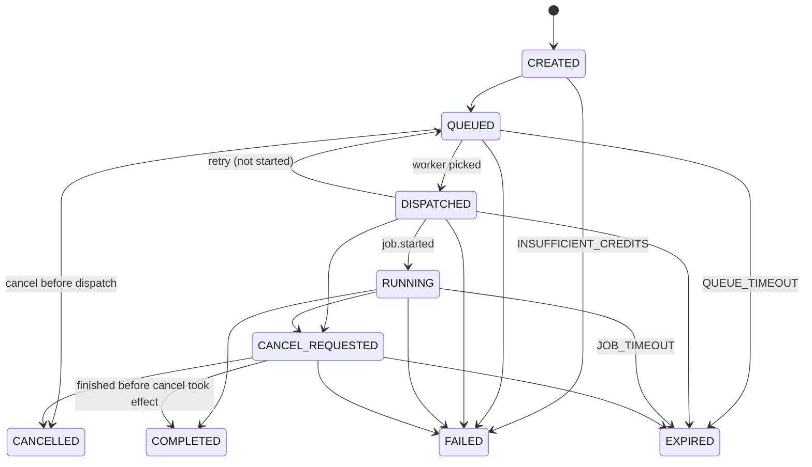

# Architecture

OpenComputeMesh v0.1 has three parts:

- a single coordinator process (`ocm/app.py` for HTTP and WebSocket, `ocm/hub.py` for live state and the job lifecycle)
- a SQLite database in WAL mode (`ocm/db.py`)
- outbound-only node agents (`ocm/agent.py`) that run jobs against loopback Ollama (`ocm/runtime.py`)

The database holds everything durable: members, nodes, jobs, job events, ledger, tariffs, pricing references and benchmarks. The hub's memory holds only what cannot be persisted: open sockets, per-job event queues, in-flight token streams and prompts. Socket ownership lives in the process, so run exactly one coordinator.

## Job state machine

From `ocm/hub.py`:

```python
TERMINAL = {"COMPLETED", "FAILED", "CANCELLED", "EXPIRED"}
TRANSITIONS = {
    "CREATED": {"QUEUED", "FAILED"},
    "QUEUED": {"DISPATCHED", "FAILED", "CANCELLED", "EXPIRED"},
    "DISPATCHED": {"RUNNING", "QUEUED", "FAILED", "CANCEL_REQUESTED", "EXPIRED"},
    "RUNNING": {"COMPLETED", "FAILED", "CANCEL_REQUESTED", "EXPIRED"},
    "CANCEL_REQUESTED": {"CANCELLED", "COMPLETED", "FAILED", "EXPIRED"},
}
CANCEL_ACK_SECONDS = 10
```



`transition()` applies a change inside the caller's transaction, so a state change and the ledger entries it causes commit together. Re-entering the same terminal state does nothing. Any other illegal move raises `IllegalTransition`. Each step also appends a row to `job_events`, such as `accepted`, `credit_reserved`, `queued`, `dispatched`, `worker_started`, `first_token`, `retry`, `cancel_requested`, `credit_settled` / `credit_released`, `worker_metric`, `completed`, `failed` and `cancelled`. These rows hold no prompt or output text.

## WebSocket messages

Every message the coordinator sends carries `type`, `protocol_version` (1) and `sent_at`. Every message the agent sends carries `type`, `protocol_version` and `node_id`.

### Browser to coordinator (`/ws/client?ticket=<ticket>`)

| Type | Fields |
|---|---|
| `client.ping` | none |
| `request.start` | `idempotency_key` (UUID), `model`, `messages`, `max_tokens?`, `temperature?`, `top_p?`, `node_id?` (pin a worker) |
| `request.cancel` | `request_id` |
| `request.status` | `request_id` |
| `benchmark.start` | `idempotency_key` (UUID), `model`, `messages`, `max_tokens?`, `temperature?`, `top_p?` |

### Coordinator to browser

| Type | When |
|---|---|
| `network.snapshot` | On connect, and whenever nodes, models or activity change |
| `client.pong` | Reply to `client.ping` |
| `request.created` | Job accepted. Carries `request_id` and `client_ref` (the idempotency key). |
| `request.state` | Reply to `request.status`, or an idempotent replay of a finished job. Carries the `receipt`. |
| `request.accepted`, `request.queued` | Lifecycle progress |
| `request.routed` | Worker chosen: `node_id`, `node_name`, `reason`, `model_digest` |
| `request.started` | Worker acknowledged `job.start` |
| `request.token` | `text`, `seq` |
| `request.completed` | `receipt`, `output_chars` |
| `request.failed`, `request.cancelled` | `code`, `message`, `receipt` (also sent without a receipt when submission is rejected, for example `MODEL_UNAVAILABLE`) |
| `benchmark.progress` | `stage`: `local` or `remote` |
| `benchmark.completed` | `benchmark` |
| `benchmark.failed` | `code`, `message` |
| `error` | `INVALID_MESSAGE`, `MESSAGE_TOO_LARGE` (over 200,000 bytes), `UNKNOWN_TYPE` |

Close codes: 4403 means the origin was rejected. 4401 means the ticket was missing, expired or already used.

### Agent to coordinator (`/ws/node`)

| Type | Fields |
|---|---|
| `node.enroll` | First message for a new node: `enrollment_token`, `capabilities` |
| `node.auth` | First message for a known node: `node_id`, `credential`, `capabilities` |
| `node.heartbeat` | `runtime_healthy`, `memory_available_bytes` (every `--heartbeat` seconds, default 20) |
| `node.capabilities` | `capabilities` (reply to `model.refresh`) |
| `job.started` | `job_id` |
| `job.token` | `job_id`, `text`, `seq` |
| `job.completed` | `job_id`, `final_stats` (Ollama `total_duration`, `load_duration`, `prompt_eval_count`, `prompt_eval_duration`, `eval_count`, `eval_duration`, `done_reason`), `worker_elapsed_ms`, `worker_ttft_ms`, `tokens_sent` |
| `job.failed` | `job_id`, `code` (`MODEL_NOT_SHARED`, `WORKER_TIMEOUT`, `RUNTIME_ERROR`, `CANCELLED`), `started`, optional `cancelled`, `worker_elapsed_ms`, `message` |

`capabilities` holds:

- `display_name`, `platform`, `architecture`, `cpu_model`, `logical_cpu_count`
- memory totals and `gpus` (each labelled with its `source`)
- `runtime_name`, `runtime_version`, `runtime_healthy`
- `models`: `model_id`, `digest`, `family`, `parameter_size`, `quantization`, `size_bytes`
- `max_concurrent_jobs`

The coordinator lowers `max_concurrent_jobs` to `OCM_MAX_CONCURRENT_JOBS_PER_NODE` if it is higher.

### Coordinator to agent

| Type | Fields |
|---|---|
| `node.registered` | `node_id`, plus `credential` the first time only (after enrollment) |
| `job.start` | `job_id`, `model`, `messages`, `options` (`max_tokens`, `temperature`, `top_p`), `deadline_seconds` |
| `job.cancel` | `job_id` |
| `model.refresh` | none |
| `node.sharing` | `enabled` |
| `node.revoked` | none |

Close codes:

| Code | Meaning |
|---|---|
| 4400 | Bad or missing hello within 15 seconds |
| 4401 | Invalid or expired enrollment token, or invalid credential |
| 4003 | Revoked by the owner |
| 4008 | Heartbeat expired |
| 4009 | Replaced by a newer connection for the same node |
| 4429 | Connection rate limit |

The agent treats 4003 and 4401 as fatal. On these codes it deletes its saved credential and exits. On any other close it reconnects.

## Scheduling

A node is eligible for a job only when all of these hold:

- its database status is `ONLINE`, `sharing_enabled = 1` and it is not revoked
- its socket is connected to this coordinator process
- its last heartbeat is within `OCM_NODE_HEARTBEAT_TTL_SECONDS`
- it advertises the exact `model_id` (and the exact digest when one is required, which only benchmarks do)
- its active jobs are below its `max_concurrent_jobs`
- it matches `node_id`, if the request pins one, and it is not excluded by an earlier failed attempt

A node is `DEGRADED` instead of `ONLINE` when its runtime is unhealthy or it shares no models. It is `PAUSED` when its owner paused it.

At submit time the coordinator checks for at least one eligible host, ignoring capacity. If there is none, the request fails at once with `MODEL_UNAVAILABLE` (409) and lists the available models. Otherwise the job enters `QUEUED` and waits up to `OCM_QUEUE_TIMEOUT_SECONDS` for capacity. It is woken whenever a node connects, finishes a job, or changes sharing.

Among eligible nodes the coordinator picks:

1. the node with the fewest active jobs,
2. then the freshest heartbeat,
3. then the lowest node id.

The `route_reason` on the receipt records why, for example `exact model present; online; 0 active job(s); within owner limit of 1; 2 eligible worker(s)`. Members may use every node in the network, including their own.

Admission limits checked before queueing:

| Condition | Error |
|---|---|
| Prompt longer than `OCM_MAX_PROMPT_CHARS` | `PROMPT_TOO_LARGE` (413) |
| `max_tokens` above `OCM_MAX_OUTPUT_TOKENS` | `MAX_TOKENS_TOO_LARGE` (400) |
| Member has `OCM_MAX_ACTIVE_JOBS_PER_MEMBER` active jobs | `TOO_MANY_ACTIVE_JOBS` (429) |
| Queue holds `OCM_MAX_QUEUED_JOBS` jobs | `QUEUE_FULL` (503) |
| Balance below the reservation | `INSUFFICIENT_CREDITS` (402) |

## Retry, timeout and cancel

- **Idempotency.** Jobs are unique per `(requester, idempotency_key)`. Submitting the same key again returns the existing job and never runs it twice.
- **Retry.** If a worker disconnects, fails to receive `job.start`, or reports `job.failed` with `started: false` while the job is still `DISPATCHED`, the job is retried once. It goes back to `QUEUED` with that node excluded and a fresh queue deadline. If no other worker appears, it expires with `QUEUE_TIMEOUT`. A job that a worker has already started is never retried. A disconnect after start fails the job with `WORKER_DISCONNECTED`, and a worker error fails it with the worker's code.
- **Queue timeout.** No eligible worker within `OCM_QUEUE_TIMEOUT_SECONDS` leads to `EXPIRED` / `QUEUE_TIMEOUT`.
- **Job timeout.**
  - The coordinator allows `OCM_JOB_TIMEOUT_SECONDS` from dispatch. When it runs out, it sends `job.cancel` and marks the job `EXPIRED` / `JOB_TIMEOUT`.
  - The agent applies the same `deadline_seconds` to its Ollama call and reports `WORKER_TIMEOUT` if it runs out first.
- **Cancel.** The requester can cancel through REST or WebSocket.
  - While the job is queued, it becomes `CANCELLED` with `cancel_effect = cancelled_before_dispatch`. The queue loop checks for a cancel about once a second.
  - After dispatch, the job moves to `CANCEL_REQUESTED`, the worker gets `job.cancel`, and the coordinator waits `CANCEL_ACK_SECONDS` (10). If the worker reports `job.failed`, the job becomes `CANCELLED` with `cancel_effect = runtime_stream_closed`. The agent closes the Ollama stream, and Ollama aborts generation when its client disconnects. If the worker disconnects, it becomes `CANCELLED` with `worker_disconnected`. With no reply, it becomes `CANCELLED` with `no_ack_from_worker`. A `job.started` that arrives after the cancel was sent leaves the job in `CANCEL_REQUESTED`. If `job.completed` arrives first, the job completes and settles normally.
- **Credits.** Every outcome except a completed job with runtime-reported usage releases the reservation and charges nothing. A settled charge never exceeds the reservation.

## Restart recovery

On startup (`Hub.recover_after_restart`):

- All non-revoked nodes are set to `OFFLINE`. They become eligible again only after their agent reconnects and authenticates. Agents reconnect automatically with exponential backoff from 1 to 60 seconds with jitter, reusing the credential saved in their state directory.
- Every non-terminal job is set to `FAILED` with `failure_code = COORDINATOR_RESTART`, and its reservation is released. In-flight jobs cannot be resumed because the prompt existed only in memory.
- Browser sessions survive because session hashes are stored in the database. WebSocket tickets, rate-limit windows and offline timers are in memory and start empty, so browsers fetch a new ticket and reconnect.
- The tariff row for the current settings is inserted if it is missing, and the network's join code hash and name are updated from settings.

While running, a sweeper checks every 5 seconds for nodes whose last heartbeat is older than `OCM_NODE_HEARTBEAT_TTL_SECONDS`. It closes their sockets (4008) and marks them offline. When a socket closes normally, the node becomes ineligible immediately and is shown `OFFLINE` after `OCM_NODE_OFFLINE_GRACE_SECONDS`, unless it reconnects first.
